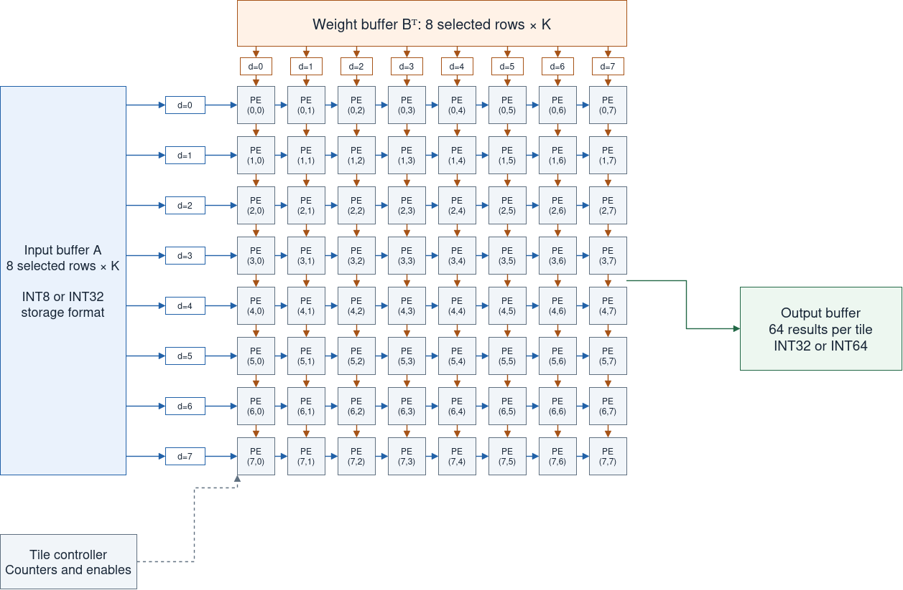

# Systolic Array Compute-Cycle Estimation

Rough ASIC estimate for the six dense projections in each of the eight TinyStories-3M transformer blocks, with batch 1 and sequence length 32.

## Engine

The engine has **8×8 = 64 processing elements (PEs)**. Each PE computes one output element and retains its own accumulator while all K products are processed. B is stored transposed as Bᵀ. Each mathematical B column is a contiguous Bᵀ row in memory.

This estimate assumes **two multiplier stages followed by one accumulator stage**: complete MAC latency **L=3**.

## Cycle formula

For A of shape M×K multiplied by B of shape K×N, **K is the number of products accumulated for each output**. It is not the PE-array size.

For an R×C PE array processing one full output tile:

$$
T_{tile}=K+(R-1)+(C-1)+(L-1)
$$

The terms count the reduction steps, row and column propagation delays, and extra MAC-pipeline latency. This formula assumes II=1 and one-cycle neighbor forwarding.

For R=C=8 and L=3:

$$
T_{tile}=K+7+7+2=K+16
$$

An actual 8×8 by 8×8 multiplication therefore takes **24 compute cycles**. An 8×128 by 128×8 multiplication produces the same 8×8 output shape but needs **144 compute cycles**, because K=128.

## Tiling the Q projection

For **32×128 multiplied by 128×128**, divide the 32×128 output into four row groups and sixteen column groups:

$$
N_{tiles}=\left\lceil\frac{M}{8}\right\rceil\left\lceil\frac{N}{8}\right\rceil=4\times16=64
$$

One tile uses eight A rows, all 128 reduction elements, and eight B columns. Each of its 64 PEs accumulates 128 products.

For A rows 0–7, compute B columns 0–7, then 8–15, continuing through 120–127. Repeat this sixteen-tile sweep for A rows 8–15, 16–23, and 24–31. 

With tiles computed sequentially and without inter-tile overlap:

$$
T_{matrix}=N_{tiles}(K+16)=64\times144=\boxed{9,216\text{ cycles}}
$$

## Dense projection results

All these matrix dimensions divide evenly into the selected output tiles.

| Projection | M×K×N | Output tiles | Compute cycles per tile | Compute cycles per matrix |
|---|---:|---:|---:|---:|
| Q, K, V, or attention output (each) | 32×128×128 | 64 | 144 | **9,216** |
| MLP expansion | 32×128×512 | 256 | 144 | **36,864** |
| MLP output | 32×512×128 | 64 | 528 | **33,792** |

Each block has four projections of the first shape, plus the two MLP projections:

$$
T_{block}=4(9,216)+36,864+33,792=\boxed{107,520\text{ cycles}}
$$

$$
T_{8\ blocks}=8(107,520)=\boxed{860,160\text{ cycles}}
$$

