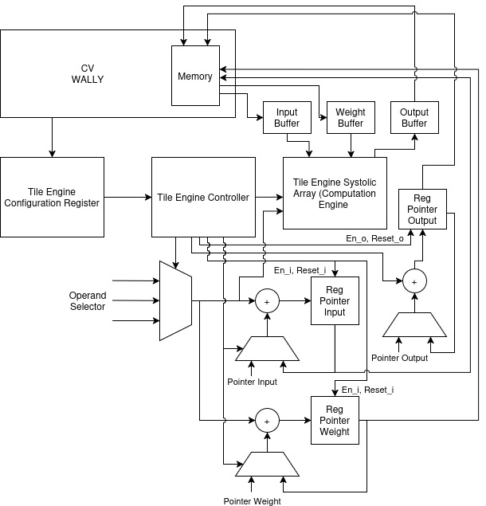

# XTILE: Configurable Matrix Tile Engine

## Architecture



XTILE is a configurable matrix engine controlled through custom RISC-V instructions. Software supplies matrix dimensions, operand types, base addresses, and zero points. The engine performs operand fetching, input centering, matrix multiplication, and output storage.

The proposed hardware uses an **8×8 systolic array** with independently configurable active rows and columns. A controller traverses larger matrices using output tiles and handles incomplete boundary tiles.

The five-instruction interface and functional behavior are implemented in Spike. The Spike implementation uses tiled computation loops; it does not model the systolic array's cycle timing. CV-Wally RTL implementation remains planned.

### Architectural components

| Component | Responsibility |
|---|---|
| CPU instruction interface | Decode CFG, SET_AB, SET_C, SET_ZP, and RUN; pass CPU-register values to engine state |
| Retained setup registers | Hold the configuration, three matrix addresses, two zero points, and initialization flags |
| Engine controller | Traverse output tiles and K, handle boundary tiles, coordinate loads/computation/stores, and report completion or faults |
| Address generator | Calculate A, BT, and C addresses from base pointers, dimensions, element sizes, and loop indices |
| Memory interface | Request operand reads and output writes; return data, completion, or memory faults |
| Operand buffers and input scheduling | Retain the operands needed by the current computation and present correctly timed values to the array |
| Centering logic | Sign-extend loaded elements and subtract the corresponding zero point without losing the exact centered value |
| 8×8 systolic compute array | Perform products and accumulation for the active output rows and columns |
| Output storage and formatter | Retain completed tile results, select four- or eight-byte output elements, and issue row-major stores |
| Completion and exception control | Keep RUN blocking until completion or a fault; preserve stores already completed |

The controller and memory interface are necessary because RUN receives **pointers**, rather than packed operand values in CPU registers. SET_AB retains those pointers; RUN later uses them to fetch the matrix elements.

The input and output buffers shown here describe logical responsibilities. Their physical organization, capacity, banking, and overlap between loading, computing, and storing remain RTL design choices. The connection to CV-Wally's LSU/cache or another memory-access path also remains to be finalized against the actual RTL.

### Systolic computation

At the functional level, each active output position retains a partial sum while K is processed. One compatible hardware organization is an output-stationary systolic array, where each active processing element holds an output partial sum, centered A values propagate across rows, and centered BT values propagate down columns. That routing requires input scheduling and timing alignment. The final physical dataflow and scheduling still need to be selected during RTL design.

For a tile beginning at output coordinates `(r0,c0)`, processing element `(i,j)` computes:

```text
tile_acc[i,j] += (A[r0+i,k] - zero_point_A)
               * (BT[c0+j,k] - zero_point_B)
```

Only valid active positions participate. An active 4×8 tile uses four output rows and eight output columns; the final tile can use fewer positions when M or N has a remainder.

The numerical contract requires exact centering and checked INT64 products/partial sums. These requirements constrain the eventual multiplier, accumulator, and overflow-detection logic. The 64-bit variables used by Spike are a functional representation, not a completed RTL datapath specification.

### CPU and memory interaction

Software first prepares contiguous operands and sufficient separate output storage, then supplies setup through the four setter/configuration instructions. On RUN, the controller fetches operands, drives the array, and stores each completed tile. Matrix elements are read from normal target memory; the base addresses are not the matrix data themselves.

The functional contract blocks subsequent program execution until RUN completes or traps. The RTL integration must provide the corresponding stall/completion, memory visibility, and exception behavior. A precise pipeline integration and cycle schedule have not yet been implemented.

## Matrix and storage contract

Software supplies contiguous, row-major arrays:

| Stored array | Shape | Element type |
|---|---|---|
| A | `[M,K]` | Signed INT8 or INT32 |
| Transposed B, denoted BT | `[N,K]` | Signed INT8 or INT32 |
| C | `[M,N]` | Signed INT32 or INT64, derived from operand types |

The operation is:

```text
C[r,c] = sum over k=0..K-1 of
         (A[r,k] - zero_point_A)
       * (BT[c,k] - zero_point_B)
```

| Dimension | Meaning |
|---|---|
| M | Number of output rows |
| N | Number of output columns |
| K | Reduction length: number of products contributing to each output |

Each row of A and each row of BT contains a contiguous dot-product vector. BT stores mathematical B transposed; the engine does not transpose B internally.

Each output starts from a zero accumulator. RUN overwrites C rather than adding to its previous contents. **Bias addition and requantization remain separate operations.**

### Output type

| A type | B type | C type | Bytes per output element |
|---|---|---|---:|
| INT8 | INT8 | INT32 | 4 |
| INT32 | INT8 | INT64 | 8 |
| INT8 | INT32 | INT64 | 8 |
| INT32 | INT32 | INT64 | 8 |

The output-width rule is:

```text
wide_output = A_TYPE OR B_TYPE
```

No separate output-width configuration bit is required. INT8 dense projections therefore retain the existing INT32-accumulation-to-INT8-requantization interface.

### Address generation

Let `sA`, `sB`, and `sC` be the respective element sizes in bytes:

| Element | Byte address |
|---|---|
| `A[r,k]` | `A_base + (r*K + k)*sA` |
| `BT[c,k]` | `BT_base + (c*K + k)*sB` |
| `C[r,c]` | `C_base + (r*N + c)*sC` |

Row strides are derived directly from the dimensions:

| Matrix | Row stride in bytes |
|---|---:|
| A | `K*sA` |
| BT | `K*sB` |
| C | `N*sC` |

There are no explicit stride registers. Software must provide the required contiguous layouts and sufficient output storage.

## Instruction interface

| Instruction | Input values from CPU registers | Behavior |
|---|---|---|
| `xtile.cfg rs1` | One packed 64-bit configuration value | Validate and retain the configuration |
| `xtile.set_ab rs1, rs2` | A and BT base addresses | Retain both operand addresses |
| `xtile.set_c rs1` | C base address | Retain the output address |
| `xtile.set_zp rs1, rs2` | A and B zero points | Retain the centering parameters |
| `xtile.run` | None | Fetch, compute, and store the complete configured matrix operation |

The setters copy CPU-register values into retained engine state. They do not fetch matrix data or write output data. Base addresses use the full 64-bit source-register values.

SET_AB, SET_C, and SET_ZP may execute before CFG. RUN requires all four categories of setup to have been supplied. A valid-address flag means an address was supplied; it does not establish that the corresponding memory is accessible or sufficiently large.

Configuration, addresses, zero points, and valid flags remain retained after execution. Updating one category does not automatically invalidate the others. Software must keep the retained setup consistent.

### Reset state

| Retained information | Reset value |
|---|---|
| Configuration | 0, invalid |
| A and BT addresses | 0, invalid |
| C address | 0, invalid |
| A and B zero points | 0, invalid |

Software must explicitly supply zero points after reset, including when both are zero. In Spike, the retained fields belong to each hart's state. They are separate from the CPU's x0–x31 registers.

## Configuration register

| Bits | Field | Width | Description |
|---|---|---:|---|
| `[63:38]` | RESERVED | 26 bits | Must be zero |
| `[37:28]` | K | 10 bits | Reduction length, stored directly |
| `[27:18]` | N | 10 bits | Number of output columns, stored directly |
| `[17:8]` | M | 10 bits | Number of output rows, stored directly |
| `[7:5]` | TILE_COLUMN | 3 bits | Active tile columns minus one; encodes 1–8 columns |
| `[4:2]` | TILE_ROWS | 3 bits | Active tile rows minus one; encodes 1–8 rows |
| `[1]` | B_TYPE | 1 bit | `0`: signed INT8; `1`: signed INT32 |
| `[0]` | A_TYPE | 1 bit | `0`: signed INT8; `1`: signed INT32 |

The register allocates **38 bits** and reserves **26 bits**. Addresses are retained separately rather than packed into these reserved bits.

M, N, and K must be nonzero. Their encoded range is **1–1,023**. Future hardware capacity and executable limits also depend on the buffer/controller implementation.

Tile height and width are independent, permitting rectangular tiles such as 4×8 and 8×4. The active tile dimensions do not have to divide M or N exactly.

Configuration packing:

```c
uint64_t cfg =
    (uint64_t)a_is_int32 |
    ((uint64_t)b_is_int32 << 1) |
    ((uint64_t)(tile_rows - 1) << 2) |
    ((uint64_t)(tile_columns - 1) << 5) |
    ((uint64_t)m << 8) |
    ((uint64_t)n << 18) |
    ((uint64_t)k << 28);
```

Software must ensure each argument fits its field before packing it. CFG validates reserved bits and nonzero dimensions before replacing retained configuration.

## Instruction encoding

All five instructions use a 32-bit R-style encoding in the **custom-0 opcode space**:

| Field | Bits | Value or role |
|---|---|---|
| funct7 | `[31:25]` | Fixed zero |
| rs2 | `[24:20]` | Second source register where used; otherwise x0 |
| rs1 | `[19:15]` | First source register where used; otherwise x0 |
| funct3 | `[14:12]` | Selects the XTILE operation |
| rd | `[11:7]` | Fixed x0; no CPU-register result |
| Opcode | `[6:0]` | `0001011`, hexadecimal `0x0b` |

| Instruction | funct3 | MATCH | MASK |
|---|---:|---|---|
| `xtile.cfg` | 0 | `0x0000000b` | `0xfff07fff` |
| `xtile.set_ab` | 1 | `0x0000100b` | `0xfe007fff` |
| `xtile.set_c` | 2 | `0x0000200b` | `0xfff07fff` |
| `xtile.set_zp` | 3 | `0x0000300b` | `0xfe007fff` |
| `xtile.run` | 4 | `0x0000400b` | `0xffffffff` |

Recognition uses `(instruction_word & MASK) == MATCH`. RUN has no variable register fields, so its complete encoding is fixed at `0x0000400b`.

The prototype targets RV64. The current Spike build recognizes the instructions without a separate XTILE ISA-string enable flag. Programs use `rv64imc_zicsr` and emit instructions through GNU `.insn` syntax:

```asm
.insn r 0x0b, 0, 0, x0, rs1, x0    # CFG
.insn r 0x0b, 1, 0, x0, rs1, rs2   # SET_AB
.insn r 0x0b, 2, 0, x0, rs1, x0    # SET_C
.insn r 0x0b, 3, 0, x0, rs1, rs2   # SET_ZP
.insn r 0x0b, 4, 0, x0, x0, x0     # RUN
```

Here `rs1` and `rs2` denote the selected CPU registers; they are placeholders for actual register names. The GNU tools have not been extended with native dotted XTILE mnemonics, so objdump may display `.insn 4, 0x...`.

## Arithmetic behavior

### Zero-point interpretation

SET_ZP interprets each source register's **low 32 bits as a signed INT32 zero point**. Upper 32 bits are ignored.

RUN applies type-dependent validation:

| Operand type | Permitted zero point |
|---|---|
| INT8 | −128 to 127 |
| INT32 | Full signed INT32 range |

A signed load is promoted before subtracting the zero point. Exact centering can require **9 signed bits for INT8** and **33 signed bits for INT32**.

### Accumulation and overflow

The functional implementation uses INT64 accumulators. Each output processes contributions in increasing K order.

For every MAC:

1. Calculate the centered product with overflow detection.
2. Require the product to fit signed INT64.
3. Add it to the accumulator with overflow detection.
4. Require the next partial sum to fit signed INT64.

An unsupported product or partial sum raises an arithmetic-overflow exception. The engine does not silently wrap or saturate it. A later cancellation does not excuse an earlier out-of-range partial sum.

For INT8/INT8, both centered magnitudes are at most 255. At maximum K:

```text
abs(sum) <= 1023 * 255 * 255
         = 66,520,575
         < INT32_MAX
```

Therefore the raw INT8/INT8 result fits INT32 under the accepted configuration and zero-point limits. Bias is separate and is not included in this bound.

The mixed INT8/INT32 modes fit INT64 under these same dimension/type bounds. Unrestricted INT32/INT32 may overflow INT64, so its product and partial-sum checks remain necessary. Results exactly equal to `INT64_MIN` or `INT64_MAX` are valid.

### Separate requantization

RUN returns raw centered dot products. Requantization follows separately:

```text
INT8 × INT8 → INT32 output → existing INT32-to-INT8 requantization

Mixed-width / INT32 × INT32 → INT64 output
                            → appropriate subsequent conversion
```

A wider-output path must use software or instructions that actually accept INT64 elements. Reinterpreting the buffer as INT32 is not a conversion. Any later scaling multiplication also needs its own width/range analysis.

## Execution using tiles

One RUN computes the entire M×N output, using active tile dimensions to traverse it:

1. Validate required setup and zero-point ranges before operand memory access.
2. Select the next output tile, in increasing row-tile then column-tile order.
3. Clear that tile's accumulators.
4. Process all K contributions, loading operands and checking arithmetic.
5. Store valid output elements in row-major order.
6. Repeat until all output tiles are complete.

Boundary tiles process only their valid rows and columns. The engine does not access operands or store results for masked-out output positions.

For example, M=32, N=128, K=128 with active tile8×8 produces 64 output tiles and performs 524,288 mathematical MACs.

The functional interface is blocking: execution advances beyond RUN after it completes, or enters a trap handler if it faults. A successful RUN represents **one retired CPU instruction**, although the hardware implementation can require many cycles and memory transactions.

## Memory and fault handling

The memory contract is:

1. Propagate normal memory-access exceptions from the memory interface.
2. Preserve output writes completed before a later fault.
3. Treat the entire C result as incomplete after any fault.
4. Require C not to overlap A or BT, permitting a complete rerun with unchanged inputs after correcting the cause.

A and BT may share input storage. Output non-overlap and sufficient buffer capacity are software obligations; the current engine does not implement an array-allocation or overlap detector.

### Partial output writes

All arithmetic for a tile completes before that tile begins storing results.

| Fault location | Output that may remain written |
|---|---|
| Setup validation | No matrix accesses have begun |
| Operand load or arithmetic within a tile | Earlier completed tiles |
| Output store within a tile | Earlier tiles and earlier successful stores in the current tile |

There is no rollback, automatic retry, or retained progress index. A rerun begins from the start and overwrites C. Software must not pass partially written C to subsequent inference operations as if RUN had succeeded.

### Exception reporting

| Condition | Exception cause | `mepc` | `mtval` |
|---|---:|---|---|
| Missing setup or invalid INT8 zero point | 2: illegal instruction | RUN instruction address | RUN instruction bits |
| Arithmetic overflow | 24 (`0x18`): custom XTILE overflow | RUN instruction address | RUN instruction bits |
| Tested unmapped input read | 5: load access fault | RUN instruction address | Faulting memory address |
| Tested unmapped output write | 7: store access fault | RUN instruction address | Faulting memory address |

In Spike, RUN accesses simulated target memory through the MMU. It uses signed byte/word loads and four/eight-byte stores according to the configured types. Other memory-access conditions follow the normal MMU behavior.

## Initial workload targets

| Block-0 operation | M | N | K | Stored operand types | Engine output type |
|---|---:|---:|---:|---|---|
| Q, K, or V projection | 32 | 128 | 128 | INT8 × INT8 | INT32 |
| Attention output projection | 32 | 128 | 128 | INT8 × INT8 | INT32 |
| MLP expansion | 32 | 512 | 128 | INT8 × INT8 | INT32 |
| MLP output projection | 32 | 128 | 512 | INT8 × INT8 | INT32 |
| Attention scores, per head | 32 | 32 | 8 | INT8 × INT8 | INT32 |
| Attention weighted values, per head | 32 | 8 | 32 | INT32 × INT8 | INT64 |

Dense projection weights already use `[N,K]` storage, matching BT. Bias addition remains outside the engine.

For future attention integration, software will prepare contiguous per-head matrices. Q and K use `[head][token][feature]`; V is prepared as `[head][feature][token]`. Per-head context results are rearranged into token-major order before the output projection. Packing, unpacking, and any required output conversion must be included in measurements.

This per-head packing is a planned software adaptation. The current block-0 implementation retains token-major Q/K/V with direct head-aware indexing, and full-block XTILE integration has not yet been performed.
